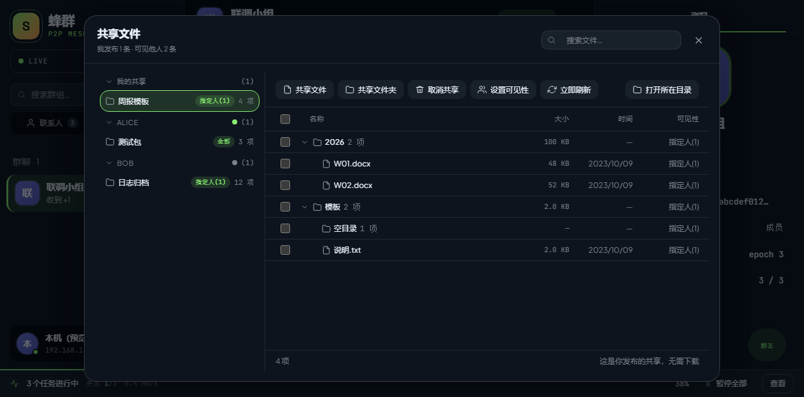
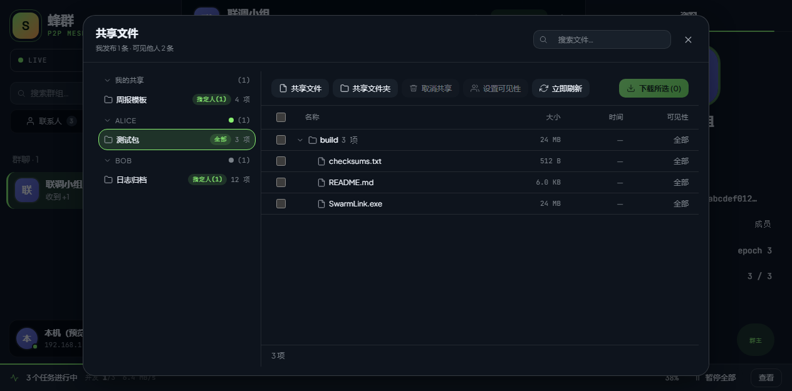
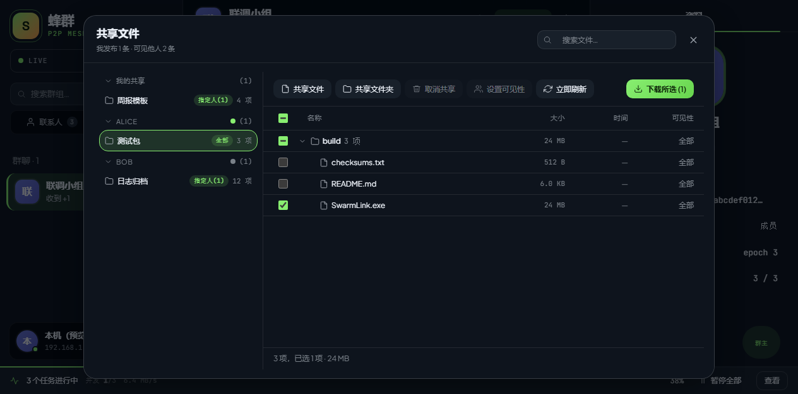
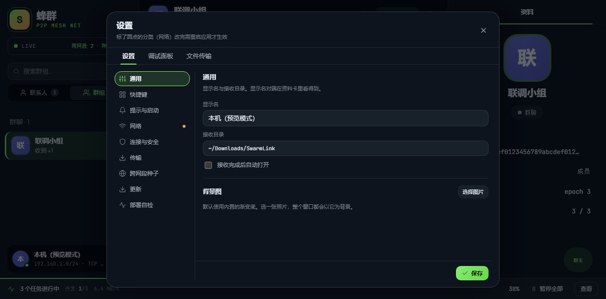

# 蜂群 · 使用说明

> 写给每一位使用者：不需要任何网络知识，看完就能上手。
> 文中所有图片都来自软件真实界面，你看到的和软件里的一模一样。

---

## 一、这是什么

**蜂群**是一个在**同一办公室、同一宿舍、同一车间**里直接互传文件和聊天的工具。

它和微信、QQ 最大的不同是：**没有服务器**。

- 不需要注册账号，不需要手机号；
- 不需要连外网，不联网也能用；
- 文件直接从你的电脑传到对方的电脑，不经过任何中转；
- 关掉软件，什么都没留下；你的聊天记录只存在你自己的电脑上。

适合的场景：团队内部分享大文件、跨楼层跨网段互传、活动现场传照片、没有外网的机房/车间内网通信。

---

## 二、安装

1. 拿到安装包（Windows 是 `.exe` 安装包，macOS 是 `.dmg`，Linux 是 `.AppImage`）。
2. 双击安装，像普通软件一样点"下一步"即可。
3. 安装完成后打开软件。

> Windows 用户如果看到防火墙提示，请选择"允许访问"——这是软件在寻找你身边的电脑，不给它联网权限就找不到人。

软件的数据（聊天记录、设置、下载的文件）默认放在：
- Windows：`C:\Users\你的用户名\AppData\Roaming\SwarmLink`
- macOS：`~/Library/Application Support/SwarmLink`

> 小提示：聊天记录和共享设置都存在这台电脑的这个目录里，重装系统前想留个心眼，可以先备份它。

---

## 三、第一次打开

第一次打开，你什么都不用填，直接就能用。

整个窗口分三块：

| 区域 | 作用 |
|------|------|
| **左边** | 搜索框、联系人和群组列表、你自己的状态 |
| **中间** | 聊天和发文件的地方 |
| **右边** | 对方的资料，或者正在传输的文件列表 |

左上角的心跳灯显示你现在的连接状态，正常情况是绿色 **LIVE**。

---

## 四、认识新节点（别人怎么出现在你列表里）

大多数情况下不需要任何操作：**同一个网络里的电脑，几秒钟内就会自动出现在你的联系人列表里**，像走进同一个房间自然看到彼此。

### 在线状态灯

列表里每个名字前面的小圆点代表对方此刻在不在：

- 🟢 **在线**：随时可以聊天、发文件
- 🟡 **仅限同网段**：能聊天，但跨网段的路由还没通
- 🔴 **离线**：对方关机或断网了

### 跨网段怎么办（"种子"）

不同楼层的网络通常是隔开的，自动发现到不了。这时用**种子**：

1. 点左下角自己的头像 → 设置 → **跨网段种子**；
2. 点 **添加种子**；
3. 填上对方电脑的地址和端口（格式：`IP:端口`，例如 `192.168.1.8:2425`）；
4. 点 **测试**，显示"可用"就通了。

种子地址从哪来？让对方的软件设置 → 跨网段种子里复制即可（支持批量导入）。

不确定网络通不通？点设置里的 **部署自检** → **运行自检**，它会逐项帮你检查，并直接告诉你是哪一段出了问题。

---

## 五、聊天

1. 在左边列表点一个人的名字；
2. 下方输入框打字，按 **Enter** 发送；想换行按 **Shift + Enter**；
3. 每条消息只带时间戳，界面干干净净。

如果发送时对方正好离线，消息会显示"发送失败"并在对方上线后**自动重试**，不用你管。

输入框上方的一排小按钮分别是：

| 按钮 | 功能 |
|------|------|
| 📎 | 发送文件 |
| 📁 | 发送整个文件夹 |
| 🖼️ | 发送图片（会直接在聊天里显示） |
| 📷 | 截图 |
| 😊 | 表情 |
| 🗑️ | 清空聊天区 |

**清空聊天区**：点输入框上方的 🗑️，界面会清空，但消息并没有被删除——点聊天区上方的时钟按钮「查看历史」就能全部恢复。

### 发文件

- 点 📎 选文件，或直接把文件**拖进聊天窗口**；
- 点 📁 可以把整个文件夹一次发过去，里面的子文件夹也会保留；
- 对方不在线也没关系，文件会先**排队**，等对方一上线自动发过去；
- 传了一半断网，恢复后**从断点继续**，不用从头再来；
- 传完的文件默认保存在"下载"文件夹里，可以在设置 → 通用里改。

### 截图与标注

1. 点输入框上方的 📷，或按 **Ctrl + Shift + A**（在后台时也有效）；
2. 屏幕变暗后，**按住左键拖动**框选要截的区域；
3. 上方工具栏可以给截图加标注，每个工具都有对应的单键快捷键：

| 工具 | 快捷键 | 工具 | 快捷键 |
|------|--------|------|--------|
| 矩形 | `R` | 文字 | `T` |
| 椭圆 | `E` | 序号标记 | `N` |
| 箭头 | `A` | 马赛克 | `M` |
| 直线 | `L` | 取色 | `I` |
| 画笔 | `P` | 选择/调整选区 | `V` |
| 荧光笔 | `H` | | |

4. 按 **Enter** 完成——截图会直接放进聊天输入框，点发送即可；
5. 也可以按 **F3** 只把截图贴到屏幕上自己看，或按 **Ctrl + S** 存成文件；
6. 后悔了随时按 **Esc** 退出，什么都不发。

---

## 六、群聊

一个人聊天不够，可以建群：

1. 点左上角 **创建群聊**（群组页签里的 + 号）；
2. 勾选要拉进来的人（一个群最多 20 人），起个名字；
3. 群可以像单聊一样发消息、发文件。

群里的文件会自动放进共享中心：其他成员之后随时都能下载，不用再传一次。

群成员名字旁边的小圆点同样显示谁在线。

---

## 七、文件传到哪去了（传输管理）

屏幕底部有一条传输进度条，点它可以展开看到所有正在传、排队、已完成和失败的任务。

也可以随时按 **Ctrl + J** 打开完整传输面板，在这里可以：

- **暂停 / 继续** 某个任务（点 ▮▮ 或 ▶）；
- **取消** 不需要的传输；
- 一眼看出每个文件传给谁、传了多少、失败原因。

> 小知识：两个人之间同时只能排一个文件的队，其他的自动排队等前面传完——这样不会互相抢网速。

---

## 八、共享中心：把自己电脑上的东西分享给大家

除了聊天时发文件，你还可以把自己的文件夹"挂"出来，让大家自己来取。

按 **Ctrl + Shift + H** 或点右上角的 **共享中心**。

### 发布共享

1. 在共享中心里点 **发布共享**；
2. 选择要分享的文件或文件夹；
3. 选择谁能看到：
   - **所有人**：这个网络里谁都能下载；
   - **仅指定的人**：只有你勾选的人能看到；
   - **仅群组**：只有某个群里的成员能看到；
4. 点确定。

你的共享会出现在列表里，显示文件数、总大小和已下载次数。

### 下载别人的共享

1. 在共享中心左边点对方的名字；
2. 浏览他的共享内容，勾选想要的文件（可以一次多选）；
3. 点 **下载选中**。

> 注意：共享是从对方电脑直接取的，**对方必须在线**。对方不在线时无法浏览他的共享，他回来后自动恢复。

---

## 九、清理失效的节点

时间久了，列表里可能留下一些"再也连不上"的名字——对方卸载了软件、换了电脑、或者换了网络段。

清理方法：

1. 在左边 **联系人** 页签里，把鼠标移到那个名字上；
2. 点右侧出现的 🗑️ 按钮；
3. 在弹出的小窗里确认。

几点说明，免得担心：

- 这只是把对方从**你自己的列表**里移除，对方那边毫无感知；
- 你们以前的聊天记录仍然保存在你的电脑上；
- 哪天他又上线了，会重新出现在你的联系人里，点一下就能接着聊。

---

## 十、界面个性化和快捷键

### 深色 / 浅色主题

默认跟随你的系统。想手动切换，点左下角自己的头像 → 设置 → 通用，或标题栏的主题按钮。浅色界面长这样：

### 换张背景图

设置 → 通用 → 背景图，选一张自己喜欢的图片，整个窗口都会以它为背景。

### 常用快捷键

不用背，忘了随时按 **Ctrl + /** 打开"快捷键一览"：

最常用的几个：

| 快捷键 | 作用 |
|--------|------|
| `Ctrl + Shift + A` | 截图（在后台也有效） |
| `Ctrl + Alt + 空格` | 唤出 / 收起主窗口 |
| `Ctrl + K` | 搜索聊天记录 |
| `Ctrl + J` | 文件传输面板 |
| `Ctrl + Shift + H` | 共享中心 |
| `Ctrl + ,` | 设置 |
| `Alt + ↑ / ↓` | 切换上/下一个会话 |

所有快捷键都可以在设置 → 快捷键里改成你顺手的组合，点一下、按新键即可。

### 搜索聊天记录

按 **Ctrl + K**，输入关键词（中文两个字就能搜），点一下结果直接跳到那条消息。记录只在你自己的电脑里，随时可查。

---

## 十一、设置里都有什么

点左下角自己的头像 → **设置**（或 `Ctrl + ,`）：

| 页面 | 管什么 |
|------|--------|
| **通用** | 你的显示名、文件保存位置、背景图 |
| **快捷键** | 查看和修改所有快捷键 |
| **提示与启动** | 开机自启、声音、最小化到托盘等 |
| **网络** | 端口等网络参数（一般不用动） |
| **连接与安全** | 加密与连接选项 |
| **传输** | 并发数、限速等（默认就够用） |
| **跨网段种子** | 跨楼层的"桥梁"地址，见第四节 |
| **更新** | 要不要自动更新 |
| **部署自检** | 网络出问题时让它帮你逐项检查 |

### 自动更新

软件会从**局域网里版本更高的电脑**获取新版（仍然不连外网）。默认"下载完再问我"，弹窗里可以选：

- **立即更新并重启**：马上装；
- **稍后提醒**：这次不装，过一会儿再问；
- **选择时间**：约一个今晚 22:00 或明天 02:00 这样的时间；
- **放弃本次**：知道了，但先不装。

---

## 十二、常见问题

**别人没出现在我的列表里？**
先看对方是不是真的开了软件；再看状态灯是不是红色（离线）。如果对方在另一个楼层/网段，让他在设置 → 跨网段种子里把他的地址发给你，按第四节添加。

还想知道得更细？点左下角自己的头像 → **调试面板**，这里一眼能看到：软件找到了几个节点、正连着几个、种子通没通（写着"失败"就是没通）、用的是哪块网卡。大部分"连不上"的原因，看一眼这里就明白了。

**发文件很慢？**
两个人之间是逐个文件传的，前面的大文件传完才会传下一个，这是正常的。想同时传多个，可以换几个对象同时发，或者去设置 → 传输调整并发数。

**文件传到一半断了？**
不用管，恢复连接后会自动接着传。失败的任务会在传输面板里显示原因，也可以手动重试。

**对方不在线，文件会丢吗？**
不会。发出去的文件会排进队列，对方一上线就自动发。

**共享里的东西对方能改吗？**
不能。共享是"只读"的，对方只能下载，不能改动你电脑上的原文件。

**换台电脑，以前的记录还在吗？**
不在。记录只存在原来那台电脑上——这也是它隐私最好的地方：没有任何服务器存着你的聊天。

**怎么彻底退出？**
点关闭按钮只是隐藏到托盘（右下角小图标），右键托盘图标选"退出"才是真正关闭。

---

## 十三、隐私说明（给你的领导/同事看的）

- 消息**不经过任何服务器**，点对点直连；
- 消息**只保存在你自己的电脑上**，没有备份、没有云端；
- 没有账号体系，设备之间用随机生成的身份标识相认，不绑定手机号、邮箱；
- 文件传输全程加密，内容不落在中间任何机器上；
- 删除数据目录后，本机的聊天记录和共享设置即被清空，不留残余。

---

*祝你用得顺手。有问题先看第十节的快捷键一览和第十一节的部署自检，大部分"连不上"都能在那里找到答案。*
